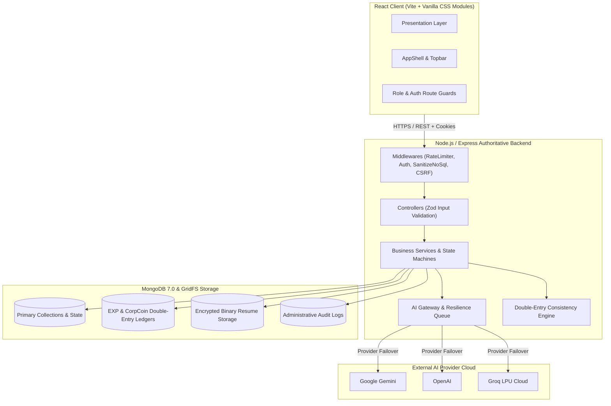

# CorpVerse — Corporate Engineering Simulation Platform

[]()
[]()
[]()
[]()
[]()

CorpVerse is an authoritative, full-stack gamified enterprise simulation platform where software engineers develop real-world engineering careers, participate in an AI-evaluated talent marketplace, climb from L1 Intern to L10 Principal, and unlock Founder Mode to incorporate their own corporate enterprises.

---

## 1. Architectural Principles

1. **The Backend is Authoritative:** The React client is an untrusted presentation layer. All EXP, CorpCoin balances, promotions, employee warnings, company health, and authorization decisions are computed and verified server-side.
2. **AI Recommends, Backend Decides:** AI models return structured evaluations and scenario scores. Backend services inspect, clamp, and validate outputs against strict Zod schemas before writing to state machines.
3. **Decoupled AI Gateway:** Multi-provider fallback across **Google Gemini**, **OpenAI**, and **Groq LPU** with circuit breaker states (`HEALTHY`, `DEGRADED`, `RATE_LIMITED`, `TEMPORARILY_FAILED`, `DISABLED`).
4. **Double-Entry Financial & EXP Ledgers:** Every EXP award and CorpCoin credit or debit is written to an immutable transaction ledger with an audit trail.
5. **Universal WCAG AA Accessibility:** Dark/light mode theme tokens, responsive layouts down to 360px viewports, and full keyboard navigation.

---

## 2. System Architecture



---

## 3. Directory Layout

```
.
├── client/                     # React (Vite) Single-Page Application
│   ├── src/
│   │   ├── api/                # Strongly-typed API client modules
│   │   ├── components/         # Design system UI primitives & layout shell
│   │   ├── hooks/              # Custom React hooks (useDocumentTitle, useAuth)
│   │   ├── pages/              # Routed view containers (Auth, Career, Workplace, Founder, Admin)
│   │   ├── store/              # Context providers (Auth, Theme, Toast)
│   │   └── styles/             # Global CSS, design tokens & theme definitions
│   ├── Dockerfile              # Multi-stage production container with Nginx
│   └── nginx.conf              # Production Nginx reverse proxy configuration
├── server/                     # Node.js + Express Authoritative Backend
│   ├── src/
│   │   ├── ai/                 # Multi-provider AI Gateway, router & adapters
│   │   ├── config/             # Environment, database & platform config schemas
│   │   ├── controllers/        # Request handling & HTTP response serialization
│   │   ├── middleware/         # Auth, CSRF, rate-limiting & NoSQL sanitization
│   │   ├── models/             # Mongoose schemas & compound indexes
│   │   ├── routes/             # REST route registration & role gates
│   │   ├── scripts/            # CLI utilities (seed-demo-data, check-consistency)
│   │   ├── services/           # Authoritative state machines & business services
│   │   └── utils/              # Structured logger, AppError, consistency checker
│   └── Dockerfile              # Multi-stage Node.js production container
├── docs/                       # Engineering specifications & architectural blueprints
│   ├── API.md                  # Comprehensive REST API reference
│   ├── ARCHITECTURE.md         # In-depth architectural blueprint
│   ├── DECISIONS.md            # Architecture Decision Records (ADR-001 through ADR-077)
│   ├── PROGRESS.md             # Implementation milestone changelog
│   ├── PRODUCTION_CHECKLIST.md # Deployment runbook & security checklist
│   └── SECURITY_REVIEW.md      # Spec Section 32 security audit report
├── docker-compose.yml          # Container orchestration for MongoDB, Server & Client
└── package.json                # Monorepo workspaces configuration
```

---

## 4. Role Hierarchy & Dual-Role Model

Users possess two independent role dimensions:

### 4.1 Career Role (`careerRole`)
- **`JOB_SEEKER`**: Candidate searching for open positions; can maintain up to 5 concurrent applications and complete AI interviews.
- **`EMPLOYEE`**: Employed engineer receiving daily technical scenarios, earning EXP, accumulating CorpCoins, and advancing through career levels.
- **`FOUNDER`**: Executive who has accumulated at least **12,000 EXP**, received the **1,000 CorpCoin** starter grant, and incorporated a corporate enterprise.
- **`NONE`**: System administrative accounts detached from simulation gameplay.

### 4.2 Platform Role (`platformRole`)
- **`NONE`**: Regular simulation user.
- **`ADMIN`**: Platform administrator with full access to `PlatformConfig`, system analytics, audit logs, and economy controls.
- **`AI_MANAGER`**: LLM operations supervisor managing provider circuit breakers, failover routing, and queue telemetry.

### 4.3 Engineering Levels & Progression
| Level | Title | Total EXP Required | Daily Task EXP Cap |
| :--- | :--- | :--- | :--- |
| **L1** | Intern | 0 | 30 |
| **L2** | Junior | 500 | 30 |
| **L3** | Junior+ | 1,200 | 60 |
| **L4** | Associate | 2,000 | 60 |
| **L5** | Mid | 3,000 | 60 |
| **L6** | Mid+ | 4,500 | 60 |
| **L7** | Senior | 6,500 | 100 |
| **L8** | Senior+ | 9,000 | 100 |
| **L9** | Lead (Founder Unlock) | 12,000 | 100 |
| **L10**| Principal | 16,000 | 100 |

---

## 5. Quick Start & Local Setup

### Prerequisites
- **Node.js**: `v20.x` or `v22.x`
- **npm**: `v10.x` or higher
- **MongoDB**: `v7.0` (Local or Atlas Replica Set)

### Installation
```bash
# 1. Clone the repository
git clone https://github.com/Trushar30/CV-THE-FINAL-LIMIT.git
cd CV-THE-FINAL-LIMIT

# 2. Install monorepo dependencies
npm install

# 3. Configure server environment
cp server/.env.example server/.env
# Edit server/.env with your MongoDB URI and API keys
```

### Running the Development Environment
```bash
# Starts both Express server (port 4000) and Vite frontend (port 5173 / 3000)
npm run dev
```

### Running with Docker & Docker Compose
```bash
# Spin up MongoDB 7.0, Server, and Client containers
docker-compose up --build

# Access the applications:
# - Frontend: http://localhost:3000
# - Backend API: http://localhost:4000/api
# - Health Probe: http://localhost:4000/api/health
```

---

## 6. Seed Demo Personas

To test all roles and flows instantly, run the automated demo seeder:

```bash
# Execute idempotent demo data seeder
npm run seed:demo
```

### Pre-Configured Demo Credentials
| Role | Email | Password | Access & Purpose |
| :--- | :--- | :--- | :--- |
| **Admin** | `admin@corpverse.dev` | `Admin@1234` | Full access to `/admin`, audit logs & platform config |
| **AI Manager** | `aimanager@corpverse.dev` | `AiManager@1234` | Access to `/admin/ai-health`, provider tests & queue load |
| **Job Seeker** | `alex.chen@corpverse.dev` | `Candidate@1234` | Onboarded candidate profile, ready to apply in `/jobs` |
| **Employee** | `employee@corpverse.dev` | `Employee@1234` | L3 Junior+ engineer with daily tasks in `/workplace` |
| **Founder** | `founder@corpverse.dev` | `Founder@1234` | Founder of Vanguard Distributed Labs with active bots in `/founder` |

---

## 7. Environment Variables Reference

### Backend (`server/.env`)
| Variable | Required | Default | Description |
| :--- | :--- | :--- | :--- |
| `PORT` | No | `4000` | HTTP port for the Express listener |
| `NODE_ENV` | No | `development` | Runtime environment (`development`, `production`, `test`) |
| `MONGODB_URI` | Yes | `mongodb://127.0.0.1:27017/corpverse` | MongoDB connection URI |
| `CORS_ORIGIN` | No | `http://localhost:5173,http://localhost:3000` | Whitelisted frontend origins |
| `JWT_ACCESS_SECRET` | Yes | — | Secret for signing short-lived access JWTs (min 32 chars) |
| `JWT_REFRESH_SECRET`| Yes | — | Secret for signing long-lived refresh tokens (min 32 chars) |
| `COOKIE_SECRET` | Yes | — | Secret for signing HTTP cookies (min 32 chars) |
| `GEMINI_API_KEY` | Optional | `""` | Google Gemini API Key |
| `OPENAI_API_KEY` | Optional | `""` | OpenAI API Key |
| `GROQ_API_KEY` | Optional | `""` | Groq LPU Cloud API Key |

---

## 8. Scripts Catalog

| Command | Workspace | Description |
| :--- | :--- | :--- |
| `npm run dev` | Root | Runs server and client concurrently with hot reloading |
| `npm run build` | Root | Builds production bundles for server and client |
| `npm run lint` | Root | Runs ESLint across all TypeScript files |
| `npm run test` | Root | Executes Vitest suites across both workspaces |
| `npm run seed:demo` | Root | Idempotently populates demo personas across all roles |
| `npm run format` | Root | Formats code with Prettier |
| `cd server && npx tsx src/scripts/check-consistency.ts` | Server | Runs double-entry ledger & orphan record consistency audit |
| `cd server && npx tsx src/scripts/check-consistency.ts --fix` | Server | Automatically repairs drifted cached balances & cleans orphans |

---

## 9. Security & Production Checklist

Please refer to [`docs/PRODUCTION_CHECKLIST.md`](docs/PRODUCTION_CHECKLIST.md) for complete instructions regarding secrets management, TLS termination, backup routines, and infrastructure hardening.

## 10. License

CorpVerse is open source software licensed under the MIT License.
